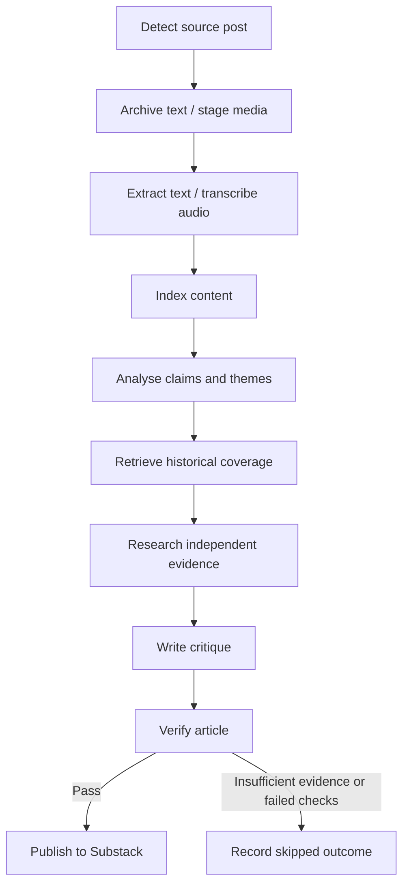

# System overview

## Purpose

Monitor configured Substack sources and produce criticism that briefly summarises their claims, identifies themes, explains factual errors or gaps in evidence, and places coverage in its historical context. Conclusions must follow evidence rather than assume every monitored claim is false.

Normal operation is automatic. Articles that pass verification may be published without approval. Cases that cannot meet the checks are skipped with a recorded reason. A manual review interface is deferred.

## Logical components

1. A scheduler and source detector discover new or changed posts.
2. A source archiver saves article text and provenance; audio/video is held temporarily for transcription and then deleted.
3. Extraction workers produce text and transcribe audio when needed.
4. An indexer makes source material available in Elasticsearch.
5. An analyser identifies claims, themes, entities, and dates.
6. Historical retrieval finds relevant earlier coverage.
7. An evidence researcher gathers independent supporting or contradicting sources.
8. A writer generates a cited critique.
9. A separate verification stage checks the proposed article.
10. A publisher creates and publishes a Substack draft.

NATS connects processing stages; persistent workflow state records progress. Logical separation does not require a separate container per stage. Start with a small number of worker processes and split deployments only where resource use or operational isolation warrants it.

## External boundaries

Development happens on the user's Mac. Execution will run in Docker on a Raspberry Pi whose details are pending. Existing NATS and Elasticsearch services live on another server. Model inference and transcription are accessed through replaceable interfaces; their execution location is not yet selected.

Vite+ is development tooling. It does not imply that this backend requires a browser application. The original tooling setup remains a separate implementation task.
